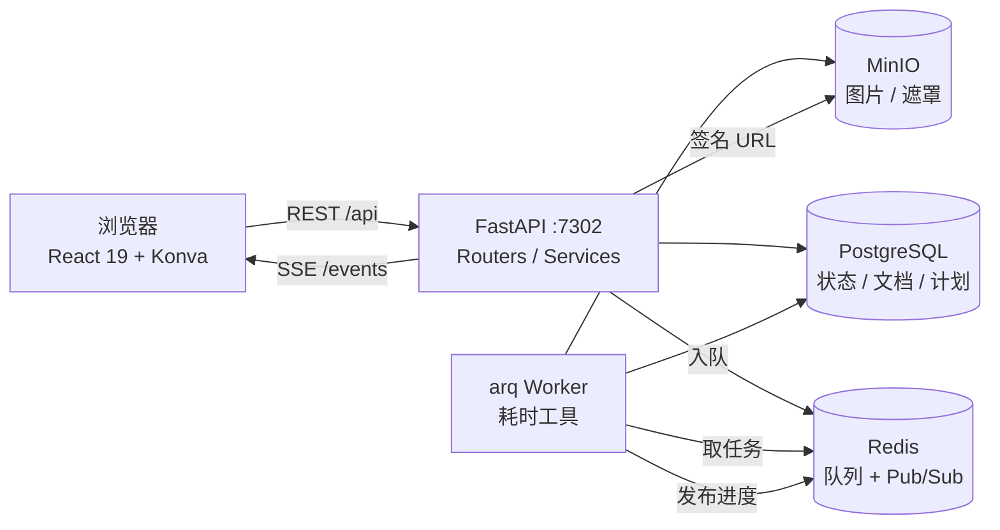

# AI 修图智能体

基于自然语言的 AI 图片编辑全栈应用：用户说一句话，Agent 自动规划修图步骤，调用工具完成抠图、调色、区域编辑、图层拆分等操作，并通过 SSE 实时推送进度。

Python 3.13 · FastAPI · LangGraph · React 19 · PostgreSQL · Redis · MinIO

## 核心功能

- **文生图 / 候选图**：输入提示词生成多张候选图，四宫格挑选，SSE 实时推送生成进度
- **画布编辑器**：基于 Konva 的图层系统、选区（点选 / 笔刷）、撤销重做、前后对比
- **自然语言修图 Agent**：模型规划工具调用，服务端校验后按依赖顺序执行
- **20+ 种编辑工具**：抠图、11 参调色、裁切/翻转/旋转、AI 换背景、扩图、超分、文字层编辑等
- **UI 与 Agent 共用工具注册表**：手动操作和 Agent 调用走同一套参数校验
- **幂等与可恢复**：以 `run_id` 作为任务 ID，计划落库，worker 重启后可从中间步骤继续
- **批量与营销物料**：多图同套处理、投放尺寸、打包导出

## 架构



三类数据分开存：

| 数据 | 存储 | 原因 |
| --- | --- | --- |
| 用户、素材、会话、画布文档、计划与状态 | PostgreSQL | 需要事务和一致查询 |
| 任务队列、进度事件、临时选区 | Redis | 低延迟、可过期 |
| 图片和遮罩字节 | MinIO | 大文件，浏览器用签名 URL 直连 |

## Agent 工作流

```text
用户指令
  → describe()：把画布、图层、选区、修订号整理成上下文
  → LangGraph plan：模型返回 tool_calls
  → verify：服务端校验工具白名单、参数模型、步骤依赖与环
  → 单步直接执行；多步先展示计划，用户确认后执行
  → 轻量工具在 API 内同步完成；耗时工具进入 Redis 队列交给 worker
  → 状态写入 PostgreSQL，进度通过 Redis Pub/Sub → SSE 推送给浏览器
```

设计原则：**模型只负责提议，服务端负责决定**。模型输出不能绕过校验直接执行。

## 技术栈

| 层 | 技术 |
| --- | --- |
| 前端 | React 19、TypeScript、Vite、Konva、zustand、TanStack Query |
| 后端 | FastAPI、SQLAlchemy 2（异步）、Alembic、Pydantic |
| Agent | LangGraph、LangChain Core、ChatOpenAI（qwen-plus） |
| 异步 | arq、Redis |
| 存储 | PostgreSQL 17、MinIO（S3 兼容） |
| 图像能力 | rembg、SAM、OCR、DashScope |
| 工程 | Docker Compose、pytest、ruff |

## 本地运行

前置：Docker、Python 3.13+、Node.js 18+、[uv](https://docs.astral.sh/uv/)。

```bash
git clone https://github.com/duhaoyang0429/ai-picture-editor.git
cd ai-picture-editor

# 1. 中间件
docker compose up -d

# 2. 环境变量（默认 IMAGE_PROVIDER=mock，不调用付费模型）
cp .env.example .env

# 3. 后端
cd backend
uv sync --all-extras
uv run alembic upgrade head
uv run uvicorn app.main:app --reload --port 7302   # 终端一
uv run arq app.worker.WorkerSettings                # 终端二

# 4. 前端
cd frontend
npm install
npm run dev
```

访问 http://localhost:7301 ，健康检查见 http://localhost:7302/api/health （`api` / `database` / `storage` 全部为 `ok`）。

需要真实模型能力时，在 `.env` 里把 `IMAGE_PROVIDER` 改为 `dashscope` 并填入 `DASHSCOPE_API_KEY`。

## 测试

```bash
cd backend
uv run pytest
```

162 个测试覆盖认证、素材、Agent 规划与校验、异步任务、编辑工具、导出和评测，外部模型调用通过 mock 隔离。

## 二次开发

在原教学项目基础上做了以下改动：

- **Agent 上下文记忆**：把最近 5 轮问答拼入系统提示，用于消解“刚才那个”“再”之类的指代；每条截断 120 字，失败轮次标注，画布文档仍是长期状态来源。配套 2 个测试。
- **失败后自动重规划**：工具执行失败时，把错误信息和剩余步骤回灌模型，重新规划一次并再次校验；每轮最多重试一次，被替换的失败步骤不再影响整轮状态。配套 2 个测试。
- **Alembic 编码修复**：`alembic.ini` 改为纯 ASCII 注释，避免中文 Windows 下 GBK 解码失败。
- **学习导航脚本**：`scripts/study.*` 按主题在编辑器中定位到对应文件与行。

后续计划：MCP 工具服务、风格模板检索。

## 目录结构

```text
backend/
  app/
    routers/     HTTP 入口（auth / assets / sessions / runs / events …）
    services/    业务逻辑（agent / tools / runs / sessions / assets）
    agent/       LangGraph 规划与校验
    tools/       工具注册表与实现
    tasks/       worker 任务
    models/      SQLAlchemy 模型
    eval/        像素级评测
  migrations/    Alembic 迁移
  tests/         pytest
frontend/
  src/
    pages/       页面
    components/  画布与编辑器组件
    hooks/       SSE、认证等
    api/         接口封装
```

## 说明

本项目基于 [yuyuanweb/ai-picture-editor](https://github.com/yuyuanweb/ai-picture-editor) 教学项目进行学习与二次开发，原项目版权归原作者所有。
